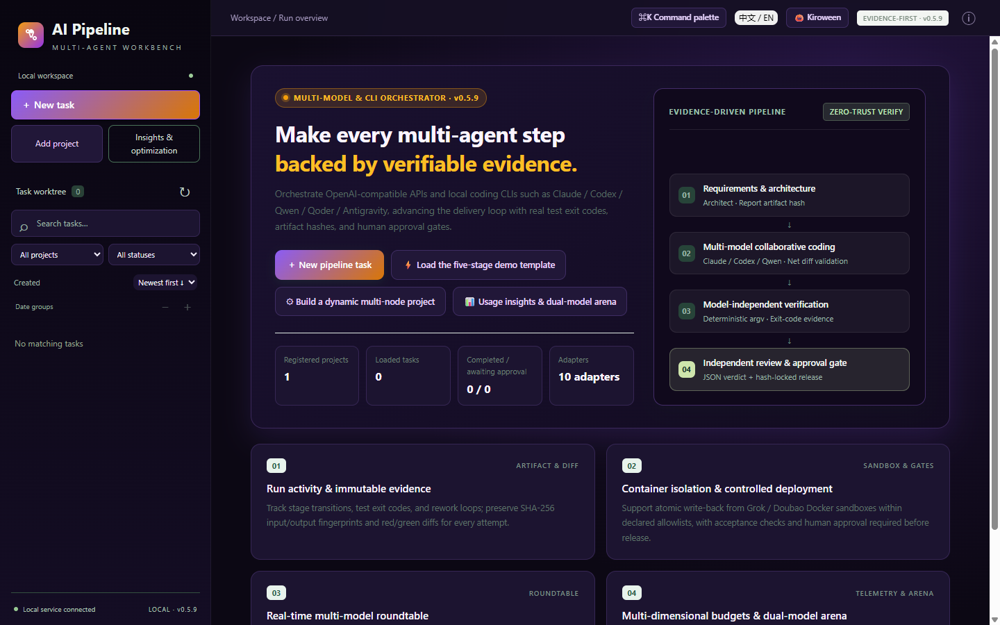
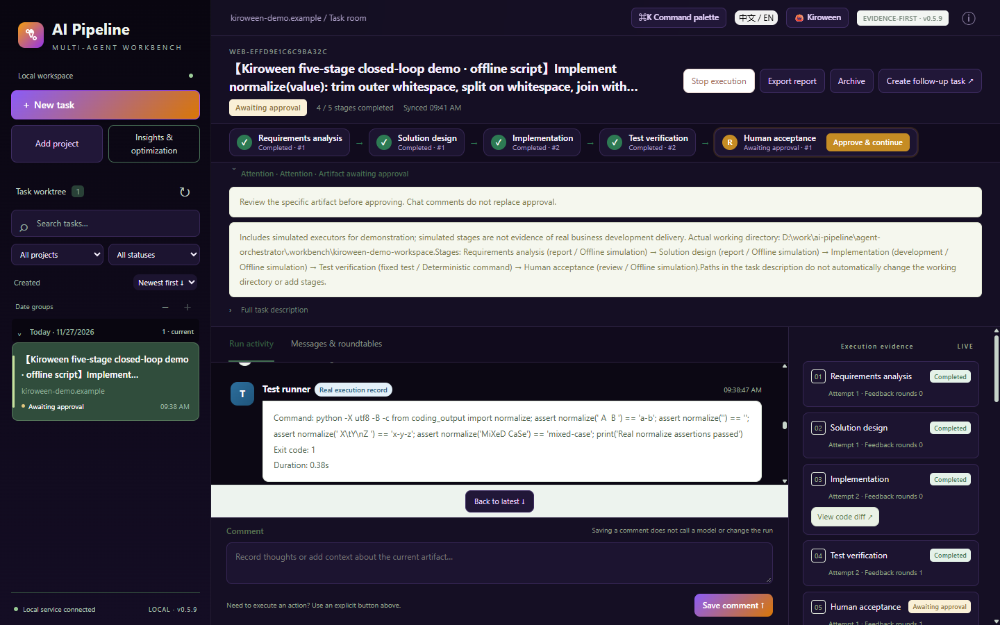
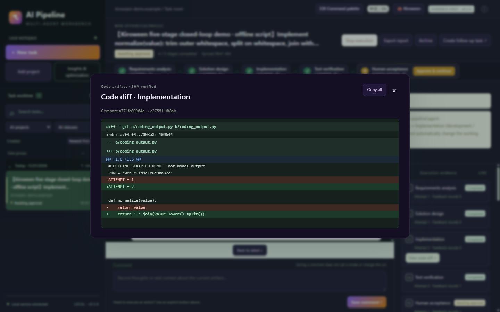
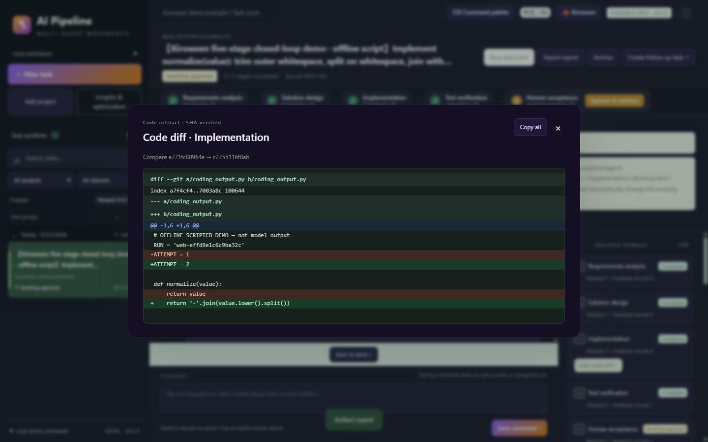
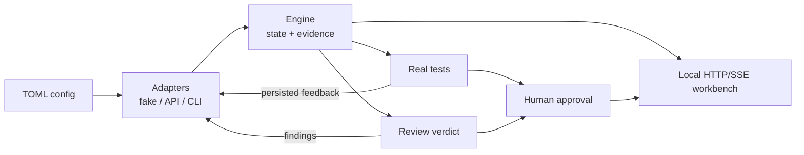

# AI Pipeline — Multi-Agent Development Workflow Orchestrator

> **Kiroween 2026 submission — `Frankenstein` category.** AI Pipeline connects model/API/CLI adapters to real tests, structured review, human approval, and a local evidence-backed workbench.

## 3-minute zero-key judge path

Run the scripted `normalize_repair` showcase without API keys, model CLI logins, or paid calls. It uses deterministic fake adapters, real Python assertions, and a human approval gate.

**Prerequisites:** Python 3.11+ and Git on `PATH`. The Python runtime uses only the standard library; no `pip install` is needed. Node.js is required for the full frontend contract tests, not for this showcase or the workbench. Supported targets are Windows and Linux/POSIX; Windows is the primary validated environment, and adapter coverage varies by platform. See [DELIVERY.md](agent-orchestrator/DELIVERY.md) for the validation boundaries.

Run these commands **from the repository root**. If you are already in `agent-orchestrator/`, skip the `cd` and run the remaining commands unchanged. Use a fresh `--run-id` for each independent run. `--lang en` selects English CLI output; `PIPELINE_LANG=en` provides the same default, while Chinese remains the default without either option. English mode covers CLI help, status, diagnostics, and common CLI-owned configuration/deployment errors; task text, paths, adapter/model logs, artifacts, and evidence remain unchanged.

```bash
cd agent-orchestrator

# 1. Static config diagnostics; no model calls or login probes.
python -X utf8 -m orchestrator.cli --lang en doctor kiroween-demo.example.toml

# 2. Run the offline pipeline. Exit 11 at the approval gate is expected.
python -X utf8 -m orchestrator.cli --lang en run kiroween-demo.example.toml --task "Build demo module" --run-id kiroween-judge-01

# 3. Inspect the evidence, approve acceptance, and finish the same run.
python -X utf8 -m orchestrator.cli --lang en status kiroween-demo.example.toml --run-id kiroween-judge-01
python -X utf8 -m orchestrator.cli --lang en approve kiroween-demo.example.toml --run-id kiroween-judge-01 --stage acceptance
python -X utf8 -m orchestrator.cli --lang en resume kiroween-demo.example.toml --run-id kiroween-judge-01
```

The demo writes its workspace and state under `agent-orchestrator/.workbench/`.

### Pipeline exit codes

| Exit | Meaning |
|---|---|
| `11` | Waiting for human approval in this demo; the CLI also uses `11` for other explicit wait/resume states. It is not completion. |
| `0` | All stages completed. |
| `1` | Execution failed. |
| `2` | Configuration or command-usage error. |

`doctor` has its own contract: `0` means no errors and `1` means diagnostics found problems.

## What you'll see

1. **Requirements and design:** the fake architect emits fixed reports for a small `normalize(value)` function.
2. **Intentional failure:** the first coding attempt returns the input unchanged. The engine runs the configured Python assertions, which really fail, records the failed attempt, and persists the test feedback before rewinding to `coding`.
3. **Repair:** the second coding attempt sees that persisted feedback and writes the normalized implementation. The same assertions pass.
4. **Nonexecuting review:** the fake reviewer parses `coding_output.py` with Python's AST tools without executing it, checks the constrained expected shape, and emits `review_verdict.json` in the run evidence directory.
5. **Human acceptance:** the `acceptance` stage waits for approval, so `run` exits `11`. After inspection, `approve` continues the run to completion and exits `0`. An additional `resume` returns `0` and reuses the completed attempts.

**This is scripted offline evidence, not model output or proof of general model quality.** The assertions, engine state transitions, feedback persistence, and approval gate are real; the reports, code attempts, and AST verdict are predetermined demo behavior.

## Local workbench

From `agent-orchestrator/`, start the dashboard in a separate terminal:

```bash
python -X utf8 -m orchestrator.cli --lang en dashboard --config kiroween-demo.example.toml --port 8766
```

Open the exact tokenized localhost URL printed by the process, such as `http://127.0.0.1:8766/#token=...`. With `--lang en`, the printed URL already includes `?lang=en`; otherwise add it before the fragment or use the visible **中文 / EN** control. The token bootstraps the local session; treat it as a secret and do not publish it. The server binds to loopback only. If the port is occupied, choose another port. Closing the browser tab does not cancel an independently running task.









### Simulation and live-model boundaries

The workbench labels configurations containing `fake` adapters as simulations. The zero-key showcase needs no API keys or CLI logins and exercises stage transitions, real local test evidence, review, and human approval. It is a scripted product demonstration, not a model benchmark.

Live API or coding-CLI examples require credentials or an existing CLI login and can incur cost. Review `task_workdir`, allowed files, test commands, and budgets before running them; start with [agent-orchestrator/README.md](agent-orchestrator/README.md).

## Architecture



Code stages require non-zero changes, test stages execute configured `argv` commands directly, and review stages require structured verdict evidence. Checkpoints and attempt archives make runs resumable without silently resetting budgets.

## Verification

See [DELIVERY.md](agent-orchestrator/DELIVERY.md) for the authoritative quick/full acceptance procedures, platform limits, evidence retention, and release checks. From `agent-orchestrator/`, run:

```bash
python -X utf8 scripts/verify_delivery.py --quick --redact-logs --output ../quick-verification
python -X utf8 scripts/verify_delivery.py --suite full --redact-logs --output ../full-verification
# Optional: run the same full suite across 8 workers using checked-in module timings.
python -X utf8 scripts/verify_delivery.py --suite full --workers 8 --timing-baseline tests/fixtures/verification-module-timings.json --redact-logs --output ../full-verification-8w
```

These commands are provided for reviewers to run against their checkout; this README does not assert a current pass result. Verification output belongs outside `agent-orchestrator/`. The module-timing file is only a scheduling hint; missing modules use a median fallback, and passing still requires zero failures, errors, or unexpected skips plus an unchanged source snapshot.

## Kiro artifacts

- [`.kiro/specs/pipeline-architecture.md`](.kiro/specs/pipeline-architecture.md) records the core architecture and evidence requirements.
- `.kiro/specs/` also contains requirements, design, and task breakdowns for the resumable engine, evidence verification, adapter layer, and web workbench.
- [`.kiro/steering/architecture-standards.md`](.kiro/steering/architecture-standards.md) defines the standard-library, evidence, adapter, and repository-hygiene rules.
- [`.kiro/hooks/verify-orchestrator-tests.json`](.kiro/hooks/verify-orchestrator-tests.json) verifies the scripted CLI demo in Kiro IDE 1.x or CLI V3 after an agent saves a matching file. The legacy `.kiro.hook` is available for IDE 0.x. Both invoke the following command from the repository root. `python -X utf8 agent-orchestrator/scripts/verify_judge_demo.py`.

## Repository layout

```text
ai-pipeline/
├── .kiro/                         # Specs, steering rules, and acceptance hook
├── agent-orchestrator/
│   ├── orchestrator/              # Engine, adapters, state, evidence, dashboard
│   ├── tests/                     # Offline regression and contract tests
│   ├── scripts/                   # Verification and release tooling
│   ├── DELIVERY.md                 # Acceptance procedures and delivery boundaries
│   └── kiroween-demo.example.toml
├── docs/screenshots/              # Workbench and approval-gate screenshots
├── LICENSE                        # MIT License
├── README.md                      # Chinese documentation
└── README.en.md                    # English judge path and overview
```

## License

Released under the [MIT License](LICENSE).
