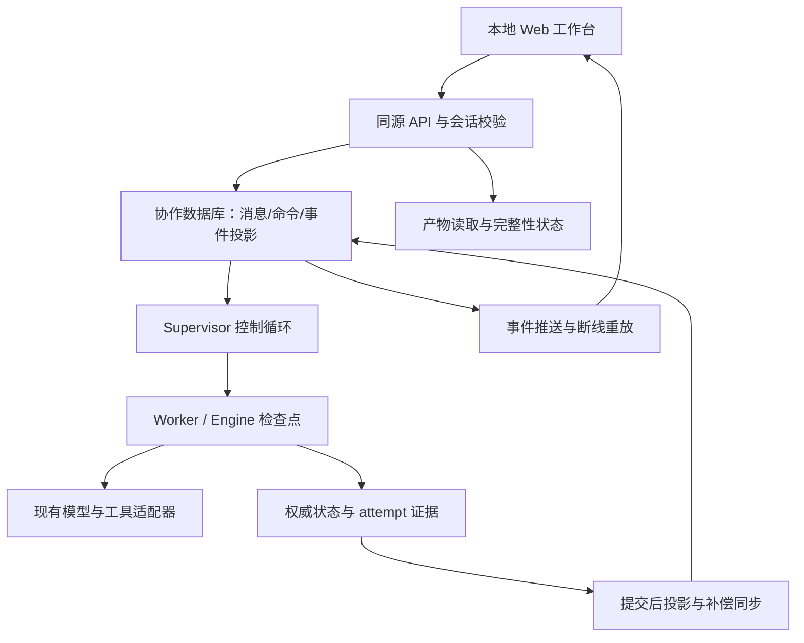

# 群聊与可视化工作台详细方案

日期：2026-11-15。对象：`agent-orchestrator`。

状态：**首版本地工作台已实施，并完成本轮发布验收**。本文保留设计依据；实际行为、验收数据和首版取舍以 `workbench-2026-11-15/实施报告.md` 与 `agent-orchestrator/README.md` 为准。首版采用标准库 HTTP/SSE、SQLite 和本地原生 JavaScript，保留零第三方运行依赖；会诊先支持双角色各一次发言，不自动采纳意见。

## 1. 重新斟酌后的结论

建议做一个**本地、单用户、面向运行证据的协作工作台**，逐步加入有限角色讨论。执行权、审批和完成判据继续由现有编排器负责。

上一版方案需要收紧的地方：

| 原设想 | 细化后的决定 | 原因 |
|---|---|---|
| 把日志展示为群聊 | 区分系统事件、角色原始发言、测试记录和人工消息 | 避免把整理后的日志伪装成 Agent 真实讨论 |
| 群里直接补需求 | 评论可直接保存；改变需求需创建关联的新 run | 当前 supervisor 固定 task/config 哈希，同一 run 不能悄悄换需求 |
| 增加暂停按钮 | 先实现协作命令通道和引擎检查点，再开放按钮 | 当前 worker 是同步执行，界面不能假装能够即时暂停模型调用 |
| 页面直接调用 approve/rerun | 提交可去重的命令，由拥有执行权的进程消费并返回结果 | 防止绕过 run 锁、重复返工或批准已经过期的产物 |
| 多 Agent 都能参与对话 | 群里可以有多个角色，但同一工作区始终只有当前编码执行者有写权 | 保持现有产物、工作区和预算一致性 |
| 立即接入通用群聊框架 | 第一版只实现有边界的议题会诊；保留 DiscussionBackend 接口 | 当前目标是少量可审计讨论，不需要先迁移整个调度体系 |
| 实时展示模型思考 | 展示实际返回的角色消息、调用状态和执行证据 | 当前适配器只有同步 run，尚无可验证的 token 流式接口 |

“群聊”在本方案中指**你与流水线角色在一个任务房间内协作**。多人账号、飞书/企业微信接入、公开聊天服务器和语音会话均不列入第一版。

## 2. 基于当前代码的接入边界

下列事实来自本地实现，实施前以代码及回归再次核对：

- `RunState` 保存阶段、事件、用量、反馈和审批；`state.json` 是运行执行状态的权威文件。[state.py](D:/work/ai-pipeline/agent-orchestrator/orchestrator/state.py)
- `manifest/success/decision/approval` 和代码 commit 提供恢复与审批证据。[evidence.py](D:/work/ai-pipeline/agent-orchestrator/orchestrator/evidence.py)
- supervisor 固定任务与配置，使用独立 worker 执行；目前等待 worker 退出，尚无交互控制循环。[supervisor.py](D:/work/ai-pipeline/agent-orchestrator/orchestrator/supervisor.py)
- 适配器接口为同步 `run(prompt, workdir, ctx) -> Result`，目前没有会话历史、自由发言调度或 token 事件流。[base.py](D:/work/ai-pipeline/agent-orchestrator/orchestrator/adapters/base.py)
- 编码阶段当前会把阶段分支合并回任务仓库，再运行测试。因此取消执行不能被解释为撤销已有修改。[engine.py](D:/work/ai-pipeline/agent-orchestrator/orchestrator/engine.py)

据此，第一批界面应从证据读取开始；交互控制是引擎能力扩展，不能只做前端。新增工作台仍兼容原有 CLI 和无人值守模式。

## 3. 产品范围与默认行为

### 3.1 三种能力，分开验收

| 能力 | 用户看到什么 | 是否调用模型 | 是否能改变运行 |
|---|---|---|---|
| 运行动态 | 阶段状态、设计/审查结果、测试失败、返工、预算 | 读取既有产物本身不调用模型 | 否 |
| 人工协作 | 留言、针对产物提问、审批、暂停、取消、创建后续任务 | 留言不调用；明确“询问角色”才调用 | 只有明确操作才产生指令 |
| 角色会诊 | 开发者与审查者围绕一个明确问题交替回复 | 是，计入指定额度 | 默认只生成提案；采用后走正常流程 |

聊天输入框默认是“留言”。旁边显式选择“询问角色”或“提出需求变更”。不能仅因为文本含“批准”“执行”或 @某角色，就自动改变执行状态。

### 3.2 典型用户流程

1. 选择已经登记的项目与配置，输入任务，查看预算、可写文件和审批方式，创建 run。
2. 进入任务房间，查看阶段推进和真实产物；可在不增加模型调用的情况下查看整个运行过程。
3. 测试失败时，系统消息显示失败用例、反馈目标和剩余轮次，并跳转到对应执行记录。
4. 需要介入时，选择“下一检查点暂停”；界面先显示请求已提交，收到执行确认后才显示已暂停。
5. 针对某次失败或 diff 发起会诊，角色读取固定快照，生成有证据引用的建议。
6. 若采纳新的需求或超出既定修复范围，生成关联的新 run；原 run 的任务、审批记录和结论不改写。
7. 完成后查看测试、审查、代码差异和交付状态；不能仅凭聊天消息显示“已交付”。

## 4. 界面布局

采用一个任务房间和按需展开的证据面板，避免同时铺开四个拥挤窗格。

```text
┌ 项目/任务名称 ── 运行状态 ── 更新于 ── 预算 ── 可用操作 ┐
│ 任务列表       │ 动态 / 讨论 / 人工留言   │ 证据面板     │
│ · 运行中       │ 设计者：设计报告        │ 当前阶段     │
│ · 等待确认     │ 系统：编码第 2 次尝试   │ 测试/差异    │
│ · 已完成       │ 测试器：2 个失败用例    │ 审查/审批    │
│ · 已停止       │ 审查者：需修复问题 #3   │ 用量/轮次    │
│                │ 你：针对 #3 的留言     │ 相关产物引用 │
│                │ 输入框 + 意图选择      │              │
└───────────────────────────────────────────────────────┘
```

### 4.1 列表和顶部状态

- 列表展示任务名、项目、执行状态、最后更新时间、是否需要人工处理；支持按项目和状态筛选。
- 顶部区分“正在执行”“暂停请求中”“已暂停”“等待审批”“取消中”“已取消”“失败”“完成”。
- 运行完成与代码交付分别展示。当前实现若只是任务仓库产生 commit，界面应写“产物已生成”，不能假定已部署或已合并到用户正式分支。
- 不提供虚构的完成百分比；显示当前阶段、已完成阶段数、attempt、反馈轮次和实际耗时。

### 4.2 动态与群聊

- 用户留言、角色原始回复、测试器输出、系统事件使用不同来源标签。
- 同一事件投影为一条稳定消息，刷新不重复。系统生成摘要必须标注“系统摘要”。
- 默认折叠连续的开始/结束、重试和长日志；保留“展开原始执行记录”。
- 每个失败可建独立议题，主动态只显示结果和链接，避免多轮讨论淹没流水线进度。
- 角色名与真实执行器分别显示，例如“审查者 · API · 返回模型 X”；两个角色使用同一模型时不表现为两个独立服务商。

### 4.3 证据和图表

| 页面/面板 | 第一版内容 | 关键约束 |
|---|---|---|
| 流水线 | 阶段、attempt、返工边、状态原因 | 来源必须是已持久化事件或状态 |
| 测试 | 命令、退出码、失败标识、耗时、输出节选 | 0 个用例不显示“测试充分”；截断需有标记 |
| 代码差异 | 固定 commit 的 diff，区分每轮和累计 | 明确比较的 base/head，不读取会变化的工作区当历史证据 |
| 审查 | verdict、issue、位置、对应 attempt | 不能用报告正文替代 JSON 结论 |
| 用量 | 已报告 tokens、未知用量预留、预算剩余 | 不能把预留量标成已实际计费；没有价格依据不显示精确金额 |
| 调优 | 来源策略、提案差异、样本量、试用/回退状态 | 同一受控样例的收益不得标为通用收益 |

宽屏显示右侧证据面板；窄屏切为全宽标签页。中文界面，操作可用键盘完成；状态用文字和图标共同表达。时间存 UTC，界面按用户时区显示，当前用户默认 Asia/Shanghai。

## 5. 架构与职责



### 5.1 权威数据必须明确

| 数据 | 权威写入者 | 页面如何使用 |
|---|---|---|
| 阶段状态、用量、反馈、执行命令收据 | 持有 run 锁的 Engine | 读取已提交快照及投影 |
| run 生命周期、进程归属、取消/超时结果 | Supervisor | 读取 job 状态及投影 |
| 文件/代码/结论/审批证据 | 现有产物与审批流程 | 按 manifest、commit 与哈希读取 |
| 用户留言、议题、待处理命令 | 协作服务 | SQLite 事务保存 |
| 实时动态列表 | 已提交状态的事件投影 | 可重建，不反向覆盖执行状态 |

不同时维护两套能决定“阶段通过”的数据库。SQLite 只承担协作与查询，原有状态和产物继续决定执行事实。

### 5.2 技术选型建议

- 核心编排器继续零第三方运行依赖。
- Web 服务作为可选安装部分，建议 Python API 服务加预构建的本地前端资源。候选为 FastAPI/Uvicorn 与 TypeScript/React；实施时先核实官方接口和锁定兼容版本，再写依赖清单。
- 用户运行已发布的工作台时不需要现场构建前端；开发构建工具只用于制作前端产物。
- 同源提供 HTTP API、静态资源和事件通道；默认只监听 `127.0.0.1`，一个 API 服务实例管理本地 worker。
- 首版使用 SQLite 保存协作记录，无需引入 Redis、消息中间件或多后端实例。
- 计划采用 SSE 推送运行动态、HTTP 提交指令。先满足断线重放，再考虑 WebSocket、逐 token 流式输出。
- 不把 AG2 或其他群聊框架列为首版强依赖。`DiscussionBackend` 可替换，后续确有开放式讨论需求时再评估框架接入。

上述是本项目的拟选方案，不代表这些依赖已经安装或完成版本验证。

## 6. 事件、消息和产物契约

### 6.1 事件

新增事件 envelope：

```json
{
  "schema_version": 1,
  "event_id": "持久化唯一标识",
  "run_id": "run-001",
  "engine_seq": 42,
  "state_revision": 18,
  "kind": "test_fail",
  "stage": "testing",
  "attempt": 2,
  "occurred_at": "UTC时间",
  "payload": {"exit_code": 1, "failure_ids": ["test_count"]}
}
```

`engine_seq` 只由运行写入者分配并持久化。协作数据库另有全局 `cursor`，用于混合消息流分页和推送；不要混用两个序号。

事件应由结构化字段生成 UI 文案，不解析 stdout 中的自然语言来推断阶段状态。

### 6.2 消息

消息包含 `message_id/run_id/thread_id/source_type/role/created_at/body/evidence_refs`，来源类型至少有 `human`、`agent_response`、`tool_result`、`system_event`、`system_summary`。

角色消息绑定真实调用信息：`stage/attempt/call_id/adapter/requested_model/returned_model`。若没有原始角色回复，只显示系统事件，不生成虚构发言。

人工发言立即持久化；“已保存留言”与“已送达模型”“已执行指令”分别显示。模型后续没有消费的消息不能标为已处理。

### 6.3 证据引用

引用标识包括 `run_id/stage/attempt/artifact_id/expected_hash`，代码还含 `base_commit/head_commit/path`。页面传 artifact_id，不传任意磁盘路径。

一个议题绑定一个固定代码快照；后续源码变化后标记“基于旧版本”，不会把旧建议默认为适用于最新实现。

协作留言、标签和讨论内容保存在独立协作存储中，不能向已封存 attempt 追加 chat.md、修改报告或重写 manifest。历史产物预览若尚未校验，应显示“未校验”；读取接口不调用 Engine.prepare 或运行适配器来刷新页面。

### 6.4 实时重放与双存储一致性

1. Engine 在内存记录事件和新状态，原子保存 state；未落盘事件不推给前端。
2. 提交后 projector 把已保存事件写入 SQLite，以 `(run_id, engine_seq)` 去重。
3. 如进程在第 1 步后退出，重启根据投影进度补齐；SQLite 暂不可用时，执行状态仍保持有效，页面显示同步滞后。
4. 用户命令先入 SQLite；执行者应用后，把 command_id 与执行收据连同权威状态一起提交。收到重复命令时从收据恢复结果。
5. 若权威状态已提交而数据库收据未更新，重启用状态中的收据补齐，不能再次执行审批或递增重跑 nonce。
6. 浏览器通过 cursor 重连重放；消息按 event_id/message_id 去重。历史清理后 cursor 失效，应明确返回“需刷新快照”，不能跳过而假装连续。

这一设计不宣称跨 SQLite 与 JSON 有原子事务；通过单写者、持久化收据和可重建投影消除重复执行与界面丢事件。

旧 run 按只读方式导入，缺少 event_id 时用固定导入算法生成标识，标记为历史记录。工作台不为展示历史修改旧 manifest 或审批文件。

## 7. 指令通道与执行语义

### 7.1 命令记录

所有有执行影响的操作携带 `command_id/idempotency_key/run_id/intent/target/expected_revision`；涉及审批或重跑时，target 必须包含阶段、attempt 与相关哈希。

命令状态为：`queued → applied / rejected / expired`，必要时增加 `processing`；最终执行收据必须保留。HTTP 接收成功只表示 queued，界面不能立刻显示审批已通过。

- 双击与网络重试返回同一条命令收据。
- 旧页面对旧 attempt 的审批必须被拒绝，并提示刷新，不能默认审批新的 attempt。
- 同一阶段有另一控制动作待处理时，按命令顺序校验；不通过的指令明确 rejected。
- 用户留言不需要执行版本匹配；执行指令必须在消费时重新验证目标和状态。

### 7.2 具体动作

| 动作 | 消费者 | 生效时机 | 界面结果 |
|---|---|---|---|
| 留言 | 协作服务 | 数据库提交后 | 已保存，不改变运行 |
| 启动任务 | Supervisor | 绑定任务/配置/预算并启动 worker 后 | 已启动或明确拒绝 |
| 批准 | Engine | 在 run 锁内重新验证目标 attempt/哈希 | 通过才更新状态 |
| 请求暂停 | Supervisor 接收，Engine 确认 | 下一个安全检查点 | 请求中→已暂停 |
| 继续 | Supervisor | 验证固定任务与配置、剩余预算后 | 恢复，不重置用量或轮次 |
| 取消 | Supervisor | 终止所属 worker/子进程树并保存结果后 | 取消中→已取消 |
| 从阶段重跑 | Engine | 无活动执行时清楚展示失效范围后执行 | 已重跑，或目标过期拒绝 |
| 变更需求 | 创建新任务操作 | 原任务稳定检查点/明确快照可用后 | 新 run，保留 parent_run_id |

### 7.3 暂停不是即时中断

新增协作检查点：模型调用或测试启动之前、一次 attempt 的用量和产物已归档之后、反馈跳回下一轮之前。

用户在模型请求或测试运行中点击暂停，当前动作继续到检查点；不得把未归档的半成品作为完成产物。界面明确写“当前调用结束后暂停”。需要立即停止使用取消。

暂停和等待审批期间保持原任务有效期：**现有总墙钟 deadline 不因暂停而延长**。界面显示剩余有效时间；超时后需要新任务，不能隐式追加预算。

实现时增加 run 级生命周期，不把 paused 混成阶段 failed。worker 需要独立的“已暂停/等待审批/已取消/被占用”退出结果，supervisor 不能把它们算作崩溃并自动重启。

### 7.4 取消不是撤销

取消只停止当前执行与继续调度。因为当前阶段提交可能已经进入任务仓库，取消后仍保留已有提交，明确列出“已应用的修改”和“尚未完成的验证”。

第一版 UI 启动的写入任务只面向用户登记的专用任务工作区；用户正式分支的自动发布另行实现“最终验收后交付”。不提供暗示可以还原任意工作区的回滚按钮。

### 7.5 需求变更保持可追踪

当前 supervisor 不允许同一 run 更换 task/config。本方案保留这个约束：

- 群里可以讨论新的需求，但先形成变更提案。
- “采用并创建后续任务”产生新的 run_id，记录 parent_run_id、来源快照、需求差异和新的预算申请。
- 原任务已生效的审批不会自动批准新任务；旧任务停在哪里、是否继续，都需要明确操作。
- UI 对“留言”和“任务变更”使用不同入口和状态，防止一句聊天悄悄使执行输入变化。

## 8. 真正的角色群聊

### 8.1 优先采用有边界的议题会诊

可用议题包括“同一测试失败两轮”“开发者与审查者对接口理解不一致”“是否接受某个实现折中”。

首版角色：你、确定性协调器、开发者、审查者。协调器负责安排发言、检查格式和额度，默认不额外调用模型扮演管理者。

一次典型会诊：

1. 绑定当前失败 issue、代码 commit 和测试记录，形成最多一页事实摘要。
2. 开发者给出一个修复方向，引用文件或失败用例。
3. 审查者核对该方向，指出可验证的反例或确认其可行。
4. 必要时允许开发者再答复一次；协调器把结论归纳为结构化提案。

角色回复采用有限结构，例如 `summary/evidence_refs/proposed_action/open_questions`。协调器使用模板装配结论并保留来源，不能在两者存在分歧时自行生成“大家已达成一致”。没有明确一致的可执行建议就结束为 need_evidence 或待人工处理。确定性协调器不承担额外的模型总结调用。

第一版预设上限：最多两个模型角色、最多三次模型发言、单次输出最多 600 tokens、会诊总额度最多 6000 tokens、最长 90 秒；所有额度仍受父运行剩余预算约束。数字为初始设计参数，需要实测后调整。

首版不发送隐藏推理过程。同步适配器调用期间只显示“角色正在处理”和实际经过时间；完整响应返回后才显示其消息，不用动画制造逐 token 输出已经实现的印象。

### 8.2 发言权、执行权和采用权分离

- 开发者和审查者会诊时都只读取固定快照，不能修改代码或执行命令。
- 会诊结果可为 `proposal`、`need_evidence`、`no_action`、`budget_exhausted`，不允许直接写阶段 verdict 或审批凭据。
- 应用修复仍经正常 code→test→review；讨论中全员同意也不能跳过测试。
- 已结束 run 的新提问创建关联的分析会话或新分析 run，另设预算，不能改写原运行的终态 metrics。
- 原运行正在写代码时，议题可先排队；第一版按稳定检查点串行处理，不同时修改同一工作区。

### 8.3 控制上下文与防止无效讨论

只提供任务约束摘要、当前 issue、所需源码片段、权威测试记录和最近几条相关回复。长历史可用标记为“系统摘要”的文本压缩，但原消息保留可查。

相同 issue、相同代码快照已经进行过会诊时，不自动再发起一次。重复观点、没有新增证据、达到轮次/预算时结束，输出需要人工决定的原因。

首版自动触发会诊只作为可选策略，默认由用户发起；它不能用来绕开已有返工上限。是否将会诊提案自动采用，需另设明确策略并验收，不包含在第一版默认行为中。

## 9. API 草案

以下路径是拟定接口；由服务端根据已登记项目解析真实配置与产物路径。

| 方法与路径 | 用途 |
|---|---|
| `GET /api/projects` | 已登记项目、可用配置和能力 |
| `POST /api/runs` | 创建任务；携带幂等键 |
| `GET /api/runs` | 游标分页的任务列表 |
| `GET /api/runs/{id}/snapshot` | 阶段、生命周期、预算、revision 和 capabilities |
| `GET /api/runs/{id}/events?after=cursor` | 分页补历史 |
| `GET /api/runs/{id}/stream` | 同一任务的消息和事件推送 |
| `GET /api/runs/{id}/messages` | 会话消息与议题分页 |
| `POST /api/runs/{id}/messages` | 保存留言，不隐式发起模型调用 |
| `POST /api/runs/{id}/commands` | 暂停、继续、取消、审批、重跑等明确操作 |
| `GET /api/commands/{command_id}` | 查询执行收据 |
| `POST /api/runs/{id}/discussions` | 发起受预算约束的角色会诊 |
| `GET /api/runs/{id}/artifacts/{artifact_id}` | 已登记产物读取、diff 或完整性状态 |

运行快照示例：

```json
{
  "run_id": "run-001",
  "state_revision": 18,
  "lifecycle": "running",
  "active_stage": "testing",
  "capabilities": {"pause": true, "cancel": true, "approve": false},
  "usage": {"reported_tokens": 3100, "reserved_tokens": 1200},
  "last_event_cursor": 260
}
```

不支持控制通道的历史/CLI 运行可以查看，但其 capabilities 必须明确不支持暂停或取消。界面据此禁用操作并说明原因。

## 10. 存储与进程组织

建议新增可选模块：

```text
orchestrator/
  collaboration/
    contracts.py       # 消息、命令、证据引用与版本约束
    storage.py         # 协作数据库访问
    projection.py      # 已提交事件投影与恢复补偿
    control.py         # 引擎检查点、命令消费、持久化收据
    discussion.py      # 固定快照的有限会诊调度
  dashboard/
    api.py             # API、会话、请求校验
    artifacts.py       # 产物读取与预览边界
    static/            # 发布时预构建的前端
frontend/              # 前端开发源文件
```

SQLite 最少需要 messages、threads、commands、event_log、projection_offsets 和 project_registry；其中 event_log 具有唯一事件 ID 与全局 cursor。不要把完整模型历史重复复制进每条状态快照。

第一版不顺带重写旧事件存储。现有 state.json 内的 events 继续兼容，新增投影只读取已提交内容；监测状态大小和保存耗时。未来如需压缩历史，先让用量/调用计数独立持久化，再迁移旧事件，不能直接截掉事件列表使 metrics 或恢复证据失真。

Engine 通过可选 ControlPort/EventSink 接口接入协作能力；默认空实现不影响现有 CLI。UI 启动的 job 带控制通道标识，恢复时沿用同一标识。supervisor 增加短周期的控制检查与心跳，避免一次阻塞 wait 直到任务结束。

Web 服务退出不应把仍有效的 worker 伪装为失败；重启后按 job、进程归属和状态重建视图。多标签页共享同一服务，不能各自启动 supervisor。

## 11. 本地控制面的必要限制

- 首版仅本机单用户，不默认开放局域网。启动后建立本地会话；写操作校验会话、来源和请求令牌，GET 不产生副作用。
- 前端不读取 API Key；凭据继续只在后端环境使用。展示日志和错误时做密钥与敏感头脱敏。
- 页面只访问登记项目内、manifest 引用的产物；对路径解析后的符号链接/目录联接再次检查边界。
- 模型 Markdown、代码和日志都是不受信文本；禁止原始 HTML/script 执行，远程图片不默认加载。
- 聊天文本不能创建任意 shell 命令、修改权限或提高预算。执行类参数来自已登记配置和明确的白名单操作。
- 取消进程时校验该进程属于当前 job/generation，不能单凭前端传入 PID 结束其他程序。

这些限制服务于“给现有执行器增加本地控制入口”的实际需求；多人身份、远程登录和外部消息平台授权留待专门设计。

## 12. 实施顺序和每步验收

| 里程碑 | 交付物 | 进入下一步的条件 |
|---|---|---|
| M0 契约与运行边界 | 本文对应的消息/命令/event schema、run 生命周期、历史导入规则 | 控制语义、权威写入者和命令幂等测试设计明确 |
| M1 只读运行工作台 | 项目列表、动态、流水线、测试、diff、用量、事件重放 | 不新增模型调用；浏览器刷新/断线不丢不重；旧 run 可查看 |
| M2 可操作工作台 | 明确留言、启动、审批、检查点暂停/继续、取消、新 run 需求变更 | 所有操作有执行收据；双击/旧页面/进程中断不产生重复副作用 |
| M3 角色会诊 | 定向提问、议题、两角色有限讨论、证据引用、提案采用入口 | 预算实际入账；讨论不能修改阶段结论、跳过测试或越权写代码 |
| M4 发布与真实验收 | 本地打包、文档、回归、真实任务演练 | 原有 208 个回归保持通过；新增控制与界面回归通过；实际演练证据归档 |

M1 是可用的只读原型；M2 完成日常操作；M3 才算具备真实多 Agent 群聊。不能在 M1 用角色头像包装日志后宣称多 Agent 已互相讨论。

暂不锁日历工期。最大不确定性是交互控制与恢复语义，而不是页面绘制；建议完成 M0 的失败场景验证后再估算工期。

## 13. 必须覆盖的验收场景

### 状态与恢复

1. 模型运行时关闭页面，执行继续；重新打开恢复同一 run，不重复调用。
2. state 已写入、事件尚未投影时终止服务，重启补齐消息且不重复。
3. 命令已执行、数据库收据尚未更新时终止 worker，恢复不重复批准/重跑。
4. 两个标签页同时批准同一 attempt，最多一次生效；一页基于旧 attempt 的操作被拒绝。
5. 暂停请求在模型调用途中提交，界面不提前显示已暂停；调用归档后生效；继续不刷新预算。
6. 取消时保留已发生用量、未知预留与提交，相关子进程退出；不误杀其他任务。
7. supervisor 对 paused/waiting_approval/cancelled 不按崩溃重启；完成产物变化后仍拒绝假缓存。

### 群聊与执行边界

8. 人工留言不引起额外模型调用；@角色但未选择“询问”同样不自动执行。
9. 会诊花费计入父任务预算；预算不足不发送请求，并显示清楚原因。
10. Agent 说“测试通过”但执行记录失败，界面和引擎仍显示失败。
11. 会诊提出的修复只有经过标准流水线才可生效；旧快照建议标记过期。
12. 改需求生成关联新 run，旧任务哈希、终态指标与审批凭据保持不变。

### 界面和性能

13. 事件顺序、分页、断线重连、重复推送和历史 cursor 失效均有自动化测试。
14. 以本机参考环境测试 20 个历史 run、单 run 一万条动态；列表与消息按页加载，默认不读全部长日志。
15. 建议性能目标：普通列表/快照请求 p95 小于 300ms；已提交事件通常在 1 秒内显示。以实际测量为准，不作为当前已达到的承诺。
16. 无网络外部资源时界面仍可正常显示本地历史；恶意 Markdown 和越界 artifact 请求被拒绝。

真实演练应包含一次人工审批、一次调用中请求暂停、一次受控取消、一次两角色会诊和一次需求变更新 run；保留命令收据、API 调用账本与产物对照，不只录成功截图。

## 14. 本次设计保留的扩展点

后续可独立增加：逐 token 回复、多用户权限、飞书/企业微信机器人、远程 worker、任务队列、开放式 Agent 框架、最终验收后交付与部署。

扩展前先验证对应契约。例如增加远程 worker 需要进程归属与工作区隔离方案；外部聊天平台只能提交受限指令，不能直接改 state；多用户需要明确谁能批准哪个产物。第一版不预先把这些复杂性放进核心状态机。

推荐下一步：先依据 M0/M1 做可追溯的只读工作台，再按 M2 接控制面，最后按 M3 接真实角色会诊。这样每一步都有可独立验收的结果，也能保留现有编排器的可恢复性。
